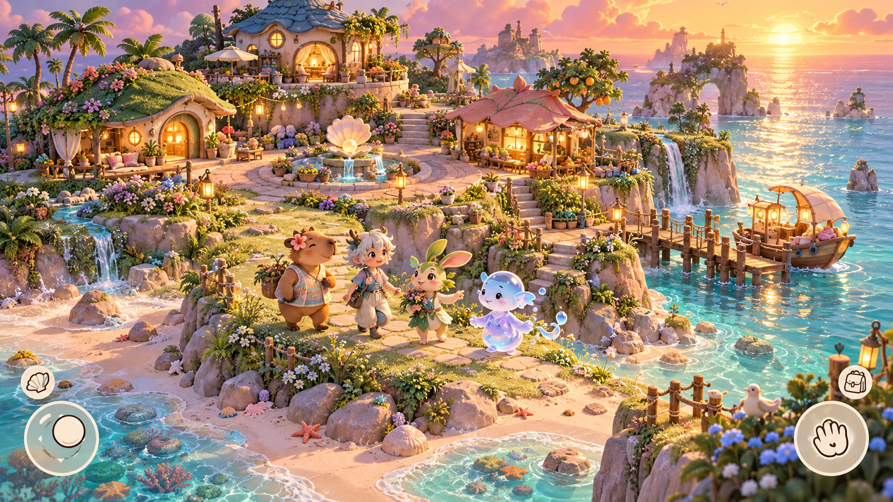
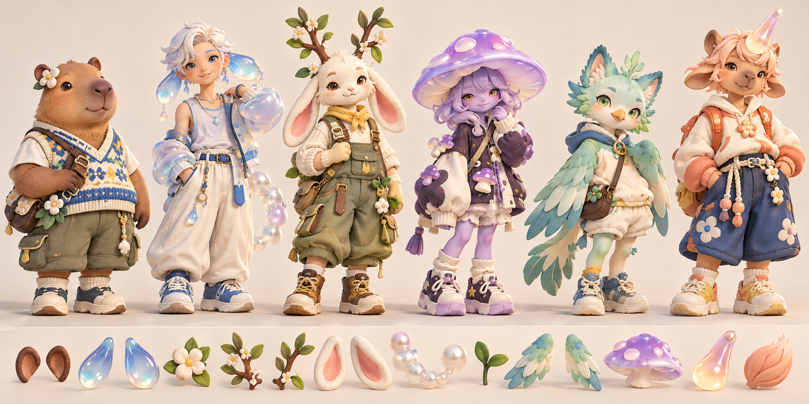
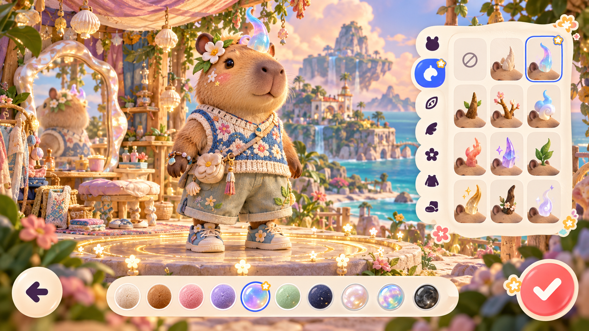

# ISOLA 아트 디렉션 & UI/UX 품질 기준

> 버전: 1.0 · 2026-10-28  
> 목적: “귀엽다”는 취향 표현을 구현·리뷰 가능한 기준으로 바꾸고, 모든 기능보다 세계의 매력과 조작 감각을 우선한다.

## 1. 북극성

ISOLA의 첫 스크린샷은 기능 설명 없이도 세 가지 반응을 만들어야 한다.

1. **저 섬에 들어가 살고 싶다.**
2. **저 캐릭터를 내 방식으로 만들어 보고 싶다.**
3. **친구와 함께 있는 장면을 찍어 공유하고 싶다.**

이 세 반응을 만들지 못하면 기능이 동작해도 디자인 단계는 완료가 아니다. 현재 Godot 기본 도형 버전은 조작과 구조를 검증하는 프로토타입이며 출시 비주얼로 승인하지 않는다.

## 2. 기준 이미지

### 세계와 플레이 화면

### 캐릭터와 모듈형 파츠

### 캐릭터 생성 UI

세 이미지는 이미지 생성 도구로 만든 아트 디렉션 목표다. 그대로 게임 에셋으로 사용하지 않고, 실제 모바일 성능 예산과 공통 리그에 맞춰 새 3D 모델·재질·UI로 제작한다.

## 3. 시각 언어

### 3.1 한 문장

**햇빛을 머금은 디자이너 토이들이, 젤리와 진주와 야생화로 만든 작은 해상 낙원에서 살아가는 세계.**

### 3.2 귀여움의 방식

- 2.5~3등신이지만 아기처럼 보이는 과도한 머리·눈 비율은 피한다.
- 둥근 실루엣과 짧은 팔다리는 유지하되, 옷·가방·신발에서 패션 취향을 드러낸다.
- 표정은 큰 눈보다 눈썹, 볼, 귀, 몸의 기울기와 작은 제스처로 만든다.
- 캐릭터마다 한눈에 기억되는 실루엣 포인트를 1~2개만 둔다.
- “예쁜 여자/멋진 남자” 프리셋 대신 소재, 색, 동식물·정령 파츠를 조합한다.

### 3.3 소재

| 계층 | 주요 소재 | 사용 위치 |
|---|---|---|
| 몸 | 벨벳처럼 부드러운 클레이·짧은 털 | 피부, 털, 얼굴 |
| 마법 파츠 | 반투명 프로스티드 젤리·오팔 | 뿔, 귀, 꼬리, 날개, 정령 몸 |
| 옷 | 실제 조직감이 느껴지는 니트·코튼 | 조끼, 와이드 쇼츠, 가방 |
| 섬 | 따뜻한 돌·젖은 모래·윤기 있는 잎 | 지형, 집, 정원 |
| 포인트 | 진주·조개·유리·금빛 등불 | 랜드마크와 상호작용 대상 |

반투명 소재는 화면당 강조 파츠 3개 이하로 제한해 모바일 오버드로우와 시각적 소음을 관리한다.

### 3.4 컬러 토큰

| 역할 | 색상 |
|---|---|
| Ocean | `#42C8D3` |
| Sea Glass | `#A8E6D2` |
| Coral | `#FF6B8F` |
| Apricot | `#FF9B68` |
| Butter | `#FFD65C` |
| Lilac | `#BDA6FF` |
| Cobalt | `#4E63F5` |
| Cream | `#FFF7E2` |
| Plum Ink | `#3A2852` |

한 화면에서는 Ocean·Cream을 기반으로 Coral 또는 Cobalt 중 하나만 강한 행동 색으로 쓴다. 모든 요소를 파스텔로 낮춰 흐릿하게 만들지 않는다.

## 4. 아름다운 섬의 조건

섬은 둥근 발판 위에 집과 나무를 올린 디오라마가 아니다. 작은 화면에서도 산책 경로와 발견 욕구가 생겨야 한다.

### 4.1 지형 구조

- 최소 세 단계의 높낮이: 해변, 생활 지대, 전망 지대.
- 화면 한쪽에서 다른 쪽으로 이어지는 주요 순환 산책로 1개.
- 지름길, 계단, 작은 다리로 연결되는 보조 경로 2개 이상.
- 바다와 닿는 경계의 60% 이상에 모래, 바위, 조수 웅덩이, 부두 중 하나를 배치한다.
- 화면 어디서든 바다 또는 하늘의 열린 면이 보여 답답하지 않아야 한다.

### 4.2 다섯 랜드마크

1. 친구가 모이는 조개 분수 광장.
2. 섬에 처음 도착하는 빛나는 페리 부두.
3. 노을을 보는 높은 전망 정원.
4. 취향 보물을 비추는 야외 상영·전시 공간.
5. 계절과 친구의 반응에 따라 변하는 정령 나무.

랜드마크는 장식이 아니라 이동 목적지와 소셜 행동의 무대다.

### 4.3 살아 있는 디테일

- 바람에 따라 나무·꽃·빨랫줄이 서로 다른 주기로 움직인다.
- 파도 포말, 물 반사, 나비, 먼지 빛이 계속되지만 같은 박자로 반복되지 않는다.
- 시간대는 아침·낮·노을·밤 네 상태로 시작한다.
- 친구의 반응은 꽃, 등불, 작은 정령 등 공간의 변화로 남는다.
- 한 화면에 움직이는 장식은 최대 8개 그룹으로 묶어 집중을 방해하지 않는다.

## 5. 캐릭터 디자인 시스템

### 5.1 공통 비율

- 전체 높이 약 2.8 heads.
- 머리 너비는 어깨의 1.05~1.25배.
- 손과 발은 제스처와 신발이 읽히도록 실제 비율보다 15~25% 크게 만든다.
- 같은 리그에서 머리·귀·꼬리·날개·의상 메시를 교체한다.
- 실루엣 테스트에서는 64px 높이에서도 종과 주요 액세서리가 구분되어야 한다.

### 5.2 첫 제작 세트

- 머리 베이스: 카피바라, 사람, 토끼, 새, 버섯 정령, 물 정령.
- 부착 파츠: 둥근 귀, 긴 귀, 잎 뿔, 젤리 뿔, 새싹, 작은 날개, 진주 꼬리.
- 의상: 니트 조끼 3종, 셔츠 3종, 와이드 쇼츠 3종, 오버올 2종, 신발 3종.
- 가방: 크로스백, 조개 파우치, 작은 배낭.
- 재질 팔레트: 털 8, 피부 8, 젤리 6, 패브릭 8.

파츠 수보다 모든 조합에서 클리핑 없이 예뻐 보이는 것이 우선이다.

## 6. UI/UX 원칙

### 6.1 세계가 UI보다 크다

- 일반 탐험 화면에서 UI가 가리는 면적은 전체의 15% 이하.
- 캐릭터 생성·꾸미기 화면에서도 3D 세계와 캐릭터를 최소 65% 이상 노출한다.
- 상시 상단 바, 하단 탭 바, 카드형 대시보드를 금지한다.
- 상황에 맞지 않는 조작은 숨기고, 가까운 대상에 따라 하나의 주 행동 버튼이 변한다.
- 5초간 조작하지 않으면 이동·행동 UI의 불투명도를 낮춘다.

### 6.2 조작은 장난감처럼 반응한다

- 주요 터치 영역 최소 52×52pt, 핵심 행동 64pt 이상.
- 눌림 80~120ms, 화면 전환 180~260ms, 큰 패널은 스프링 오버슈트 4% 이하.
- 가구를 잡으면 3~5% 커지고 작은 그림자가 생긴다.
- 유효한 배치에는 짧은 자석 스냅과 촉각 피드백, 불가능한 배치에는 색뿐 아니라 흔들림과 아이콘을 함께 쓴다.
- 저장 성공은 토스트보다 방 안에 잠깐 피어나는 반짝임이나 작은 정령 반응으로 알린다.

### 6.3 UI 형태

- Cream 반투명 표면 + Plum Ink 2~3px 외곽선.
- 선택 상태는 Cobalt 외곽선과 작은 별 스티커를 함께 사용한다.
- 주요 확인은 Coral, 편집 보조는 Butter, 정보 선택은 Lilac.
- 그림자는 검정 대신 Plum Ink 18~24%를 사용한다.
- 아이콘은 2px 둥근 선과 한 가지 덩어리 면을 함께 사용해 작은 크기에서도 읽히게 한다.

### 6.4 접근성

- 모든 색 선택에는 패턴·아이콘·텍스트 레이블을 함께 제공한다.
- 모션 감소 시 카메라 흔들림, 스프링, 파티클을 정적인 페이드로 바꾼다.
- 텍스트 배율 130%에서도 핵심 버튼과 콘텐츠가 잘리지 않아야 한다.
- 꾸미기와 캐릭터 생성은 색각 모드와 무관하게 현재 선택이 외곽선으로 구분되어야 한다.

## 7. 화면별 품질 게이트

각 화면은 1~5점으로 평가한다. 아래 항목 중 하나라도 4점 미만이면 다음 기능 개발보다 시각 개선을 먼저 한다.

| 항목 | 질문 |
|---|---|
| Desire | 처음 보는 사람이 “해보고 싶다”고 느끼는가? |
| World first | UI보다 세계와 캐릭터가 먼저 보이는가? |
| Distinctiveness | 다른 코지 게임의 일반적인 화면과 구분되는가? |
| Tactility | 재질, 그림자, 애니메이션에서 만지고 싶은 느낌이 드는가? |
| Readability | 6.1인치 가로 화면에서 행동과 이동 경로가 즉시 읽히는가? |
| Cohesion | 캐릭터·환경·UI가 같은 브랜드의 작품처럼 보이는가? |
| Inclusivity | 외형 선택이 성별·종 고정관념에 묶이지 않는가? |
| Performance | 목표 기기에서 안정적인 30fps, 권장 기기에서 60fps를 유지하는가? |

### 리뷰 절차

1. `844×390`, `1280×720`, 실제 iPhone 가로 화면 스크린샷을 만든다.
2. UI를 가린 스크린샷에서도 장면의 목적과 동선이 읽히는지 확인한다.
3. 회색조·색각 시뮬레이션·텍스트 130%로 다시 확인한다.
4. 첫 사용자 5명에게 설명 없이 5초간 보여주고 무엇을 하고 싶은지 묻는다.
5. Desire와 Distinctiveness가 평균 4점 이상일 때 구현을 승인한다.

## 8. 현재 프로토타입과의 차이

| 영역 | 현재 | 목표로 바꿀 것 |
|---|---|---|
| 섬 | 평평한 원형 지형과 기본 도형 | 높낮이, 해안선, 부두, 폭포, 랜드마크가 있는 산책 가능한 세계 |
| 캐릭터 | 기본 도형으로 만든 실루엣 | 공통 리그 기반 제작 모델, 니트·털·젤리 소재, 패션 레이어 |
| 조명 | 단일 태양광과 단색 환경 | 노을 림라이트, 구운 간접광, 물 반사, 시간대 팔레트 |
| UI | 큰 크림 패널과 텍스트 버튼 | 세계 위에 뜨는 작은 스티커 컨트롤, 상황형 행동, 자동 페이드 |
| 꾸미기 | 버튼을 누르면 지정 슬롯 배치 | 직접 드래그, 미리보기 유령, 스냅·진동·공간 반응 |

다음 구현은 새 기능 수를 늘리기보다 이 차이를 줄이는 순서로 진행한다.

## 9. 제작 순서

1. 섬 블록아웃: 높낮이·경로·랜드마크를 회색 지형으로 검증.
2. 대표 카피바라 한 종을 제작 품질로 완성하고 공통 리그·재질 기준 확정.
3. 노을 조명과 물·바람·꽃의 환경 움직임 확정.
4. 캐릭터 생성 화면을 스티커형 UI로 교체.
5. 직접 드래그 꾸미기와 촉각 피드백 구현.
6. 같은 기준으로 사람·정령 파츠와 집 내부를 확장.

대표 캐릭터와 첫 섬 장면이 품질 게이트를 통과하기 전에는 상점, 미니게임, 실시간 채팅을 우선하지 않는다.
