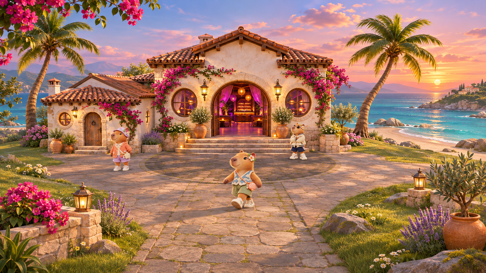

# 카피바라 스토리 · 월드 비주얼 디렉션 v2

## 목표

월드는 **동화적인 지중해 섬 + 자연광 기반 스타일라이즈드 리얼리즘**을 지향한다. 사진처럼 무겁거나 저연령용 플라스틱 장난감처럼 보이지 않게 하고, 노을 바다의 깊이와 풀·나무·돌의 촉감을 살린다. 첫 화면에서 클럽이 분명한 목적지로 읽히되 섬과 바다가 배경 장식이 아니라 머물고 싶은 장소로 보여야 한다.

## 이번 구현 원칙

- 모래 원판 하나였던 지형을 해변, 완만한 잔디 언덕, 돌광장과 해안 바위의 여러 층으로 나눈다.
- 식생은 반복 배치하되 인스턴싱으로 드로콜을 억제한다. 카메라 가까이는 꽃과 풀, 중경은 관목과 올리브나무, 원경은 야자수 실루엣으로 구성한다.
- 바다는 두 크기의 파동, 얕은 수심의 청록색, 해안 거품, 석양 반사를 서로 다른 신호로 표현한다.
- 낮은 석양 방향광과 차가운 하늘 보조광을 함께 써서 형태가 납작해지지 않게 한다. ACES 톤 매핑으로 밝은 창과 노을의 하이라이트를 부드럽게 보존한다.
- 클럽 전면에는 화분, 꽃, 랜턴과 따뜻한 발광을 배치해 입구의 시선 집중과 진입 동기를 강화한다.
- `prefers-reduced-motion`에서는 물결 시간 변화와 식생 흔들림, 공기 입자의 속도를 줄이거나 멈춘다.

## 제작·성능 기준

- 최종 환경 에셋은 GLB(glTF 2.0)를 기본으로 하고 Meshopt 또는 Draco, KTX2/Basis 텍스처 압축을 적용한다.
- 주 랜드마크 권장 예산: LOD0 40–80k, LOD1 15–25k, LOD2 4–8k triangles. 히어로 텍스처는 최대 2K, 반복 소품은 1K 이하를 우선한다.
- 풀, 꽃, 돌과 반복 수목은 인스턴싱한다. 투명 잎은 과도한 오버드로를 피하고 알파 클립을 우선한다.
- 모바일은 DPR과 그림자 해상도를 제한하고, 원거리 입자·식생 밀도와 셰이더 파동 수를 단계적으로 줄인다.
- 다음 아트 패스에서는 현재의 2D 카피바라 컷아웃을 동일한 실루엣의 3D 리그 캐릭터로 전환하고, 건물 전면 이미지와 절차형 측면의 재질 차이를 하나의 GLB로 통합한다.

## 참고한 공개 자료

- [Sky: Children of the Light 디자인 인터뷰](https://developer.apple.com/news/?id=zm47it7t)
- [Three.js 후처리 가이드](https://threejs.org/manual/pages/post-processing.html)
- [Three.js 색 관리 가이드](https://threejs.org/manual/pages/color-management.html)
- [React Three Fiber 성능 확장 가이드](https://github.com/pmndrs/react-three-fiber/blob/master/docs/advanced/scaling-performance.mdx)
- [Khronos glTF](https://www.khronos.org/gltf/)
- [Khronos Asset Creation Guidelines 2.0](https://www.khronos.org/blog/introducing-asset-creation-guidelines-2.0-siggraph-2025)
